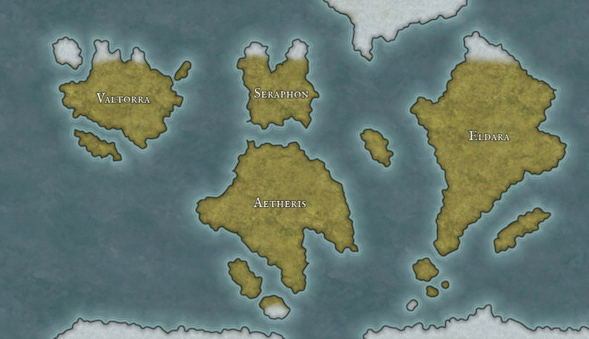

<div align="center">



<h1>The Elandis Wiki</h1>

<p><em>The living, player-written encyclopaedia of Elandis —<br>
a homebrew world of four continents remade by catastrophe.</em></p>

<p>
<a href="https://elandis.world">Read the wiki</a> ·
<a href="#-how-to-contribute">How to contribute</a> ·
<a href="#-the-house-rules">House rules</a>
</p>

</div>

---

Welcome, players. This repository holds the **public** half of the Elandis vault — every
page you can see on the wiki. It is yours to help build. Spotted a typo? Know more about a
place your character has been? Want to flesh out your own character page? You are warmly
invited to make changes.

This guide explains exactly how, **even if you have never used GitHub or "git" before.**
Take it slowly; nothing here can break the wiki, and nothing you submit goes live until
Riv has reviewed and approved it.

> [!NOTE]
> You can only edit pages that already exist in this repository. The wiki is a *subset* of
> the full campaign notes — secrets the table hasn't uncovered yet live in a separate
> private vault you can't see. So you can't accidentally spoil anything.

## A few words first — what is all this?

Three terms come up constantly. Here they are in plain English:

- **Repository ("repo")** — this whole collection of wiki pages, stored on GitHub. Think of
  it as the shared folder for the world.
- **Branch** — your own private copy of the pages to scribble on. You make your changes on a
  branch so the live wiki is never touched until your work is approved. Creating a branch is
  cheap and safe — it's just a workspace with your name on it. Always create a new branch for each set of changes you want to make.
  These are automatically deleted when a pull request is completed.
- **Pull request ("PR")** — when your branch is ready, you open a pull request. That's simply
  you saying *"here are my changes — please review them and pull them into the real wiki."*
  Riv gets notified, reads your changes, and either approves them (they go live) or leaves a
  comment asking for a tweak.

That's the whole cycle: **branch → edit → pull request → Riv approves → live.** Everything
below is just different ways of doing those same four steps.

## ✍️ How to contribute

Pick the path that matches how comfortable you feel. They all end in the same place.

| | Best for | What you need |
|---|---|---|
| **[Option A — In your browser](#option-a--edit-in-your-browser-easiest)** | Quick fixes, typos, small edits. **Start here if you're not technical.** | Just a GitHub account |
| **[Option B — GitHub Desktop + Obsidian](#option-b--edit-on-your-computer-github-desktop)** | Bigger edits, writing a whole page, seeing it rendered as you type | A free app or two installed |
| **[Option C — Command line](#option-c--the-command-line-for-the-technical)** | Folks already comfortable with git | git installed |

Before any of them, you need a (free) GitHub account and contributor access:

1. Sign up at [github.com](https://github.com).
2. Send Riv your GitHub username and ask to be added as a contributor to the wiki repo.
3. Accept the email invitation GitHub sends you.

---

### Option A — Edit in your browser (easiest)

No installs, no command line. You do everything on the GitHub website. **This is the
recommended path for non-technical players**, and it handles the branch and the pull request
for you automatically.

1. **Find the page** you want to change. Browse the folders here on GitHub (for example
   `Codex/Characters/`) and click the `.md` file you want to edit.
2. **Click the pencil icon** (✏️ "Edit this file") near the top-right of the page.
3. **Make your changes** in the text box. The pages are written in Markdown — mostly just
   plain text. See [the house rules](#-the-house-rules) for the small conventions to follow.
4. When you're happy, click the green **"Commit changes…"** button at the top-right.
5. A box pops up. Add a short note in the description of *what* you changed and *why*
   (e.g. *"Fixed the date of the Siege of Valtorra"*).
6. Crucially, choose **"Create a new branch for this commit and start a pull request."**
   GitHub will suggest a branch name — you can leave it as is.
7. Click **"Propose changes"**, then on the next screen click **"Create pull request."**

That's it. You just created a branch *and* opened a pull request in two clicks, without ever
thinking about either. Riv is now notified and will review it. You can keep editing the same
page — your further commits get added to the same pull request automatically.

> [!TIP]
> To change several pages in one go, it's cleaner to make your *first* edit create the branch
> (steps above), then for each following page use the pencil icon and choose **"Commit
> directly to the [your-branch-name] branch"** so all your edits land in the same pull request.

---

### Option B — Edit on your computer (GitHub Desktop)

If you want to write more than a quick fix, editing on your own computer is far nicer —
especially in **[Obsidian](https://obsidian.md)**, the free note-taking app the whole wiki is
built in. Obsidian shows the links, images and formatting exactly as they'll appear on the
published site. **GitHub Desktop** is a friendly app that does all the git steps with buttons
instead of commands.

**One-time setup**

1. Install **[GitHub Desktop](https://desktop.github.com)** and sign in with your GitHub account.
2. In GitHub Desktop: **File → Clone repository →** pick the wiki repo from the list **→ Clone.**
   This downloads a copy to your computer. Remember where it saves it.
3. *(Optional but recommended)* Install **[Obsidian](https://obsidian.md)**, choose
   **"Open folder as vault,"** and select the folder you just cloned. Now you can edit the
   pages as nicely-rendered notes.

**Each time you want to make changes**

1. **Open GitHub Desktop first** and click **"Fetch origin"** (top bar) to pull down everyone
   else's latest changes, so you're starting from the current version.
2. **Create a branch for your work:** click the **"Current branch"** dropdown at the top →
   **"New branch."** Give it a short name describing your work, like `fix-valtorra-dates` or
   `flesh-out-my-character`. Click **"Create branch."**
   *(Always make a branch — never edit the `main` branch directly.)*
3. **Make your edits** in Obsidian (or any text editor). Save the files as normal.
4. Switch back to **GitHub Desktop.** Your changes appear in the left-hand list. In the bottom-
   left, type a short **summary** of what you did, then click **"Commit to [your-branch-name]."**
   A "commit" is just a saved checkpoint of your work.
5. Click **"Publish branch"** (or **"Push origin"**) at the top to upload your branch to GitHub.
6. GitHub Desktop will show a **"Create Pull Request"** button — click it. Your browser opens to
   the pull request page; add a short description and click **"Create pull request."**

Done. The same branch → edit → PR cycle, just with buttons. To make more changes later, repeat
from step 1 (start each new piece of work with a fresh branch).

---

### Option C — The command line (for the technical)

If you're comfortable with git, the flow is what you'd expect:

```bash
# One-time: clone the wiki repo
git clone git@github.com:AlexSandilands/elandis-wiki.git
cd elandis-wiki

# Each change: branch, edit, commit, push
git switch main && git pull          # start from the latest
git switch -c fix-valtorra-dates     # create + switch to a new branch
# ...edit the Markdown files...
git add -A
git commit -m "Fix the date of the Siege of Valtorra"
git push -u origin fix-valtorra-dates
```

Then open the pull request from the link git prints, or on the repo's GitHub page.

---

## 🔍 What happens after you open a pull request

1. **Riv is notified** and reviews your changes — usually within a week or so.
2. They might **approve and merge** it straight away (your changes go live on the wiki), or
   **leave a comment** asking for a small change. If so, just make the edit on the same branch
   (same as before) and it's added to the existing pull request automatically.
3. Once merged, you can delete your branch — GitHub offers a button for this. Next time, start
   fresh from step 1.

> [!IMPORTANT]
> Every pull request needs Riv's approval before it can be merged — that's deliberate, not a
> sign anything's wrong. Riv reserves the right to accept, edit, or decline any contribution,
> and will sometimes rework the formatting or prose of accepted changes to keep one consistent
> voice across the world. Don't take it personally.

## 📐 The house rules

A few small conventions keep the wiki consistent. Follow these and your pull requests will sail
through:

- **Links between pages** use double square brackets around the page's name:
  `[[The Bloody Nails]]`, `[[Valtorra]]`. Link by name, not by file path — it resolves wherever
  the page lives.
- **Don't add images yourself.** Every picture on the wiki goes through a specific pipeline so
  the whole site keeps one art style. If a page needs art, ask Riv rather than dropping an image
  in.
- **Match the surrounding style.** Glance at a finished page and mirror its tone, headings and
  formatting. In-world, encyclopaedic prose — not out-of-character notes.
- **Your character page is yours.** The player-character pages are intentionally sparse for you
  to fill in. Flesh out your own freely; check before substantially rewriting someone else's.
- **One topic per pull request.** Smaller, focused pull requests are far easier to review than a
  giant mixed bag of unrelated edits.

## 🆘 Getting stuck

Git can feel intimidating at first — that's normal, and you genuinely cannot break anything that
matters here, because nothing merges without review. If you get tangled up, the safe reset is:
throw the branch away and start a new one from `main`. And if all else fails, just send Riv your
changes however is easiest and they'll help get them in.

Happy worldbuilding. ⚔️
